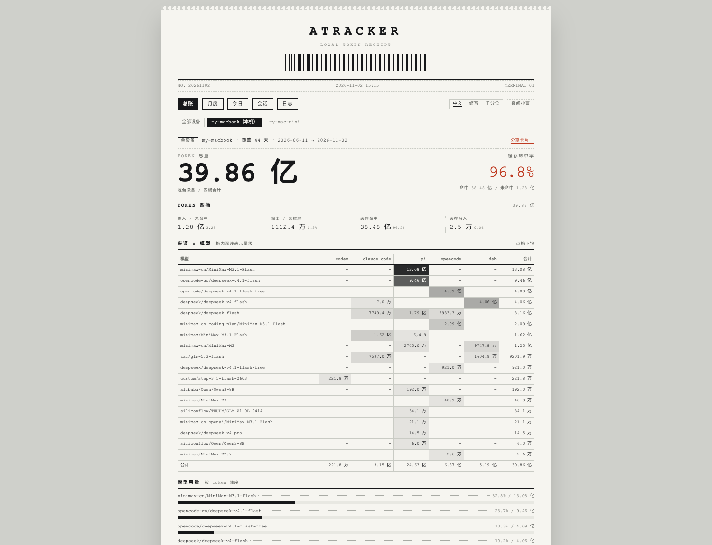
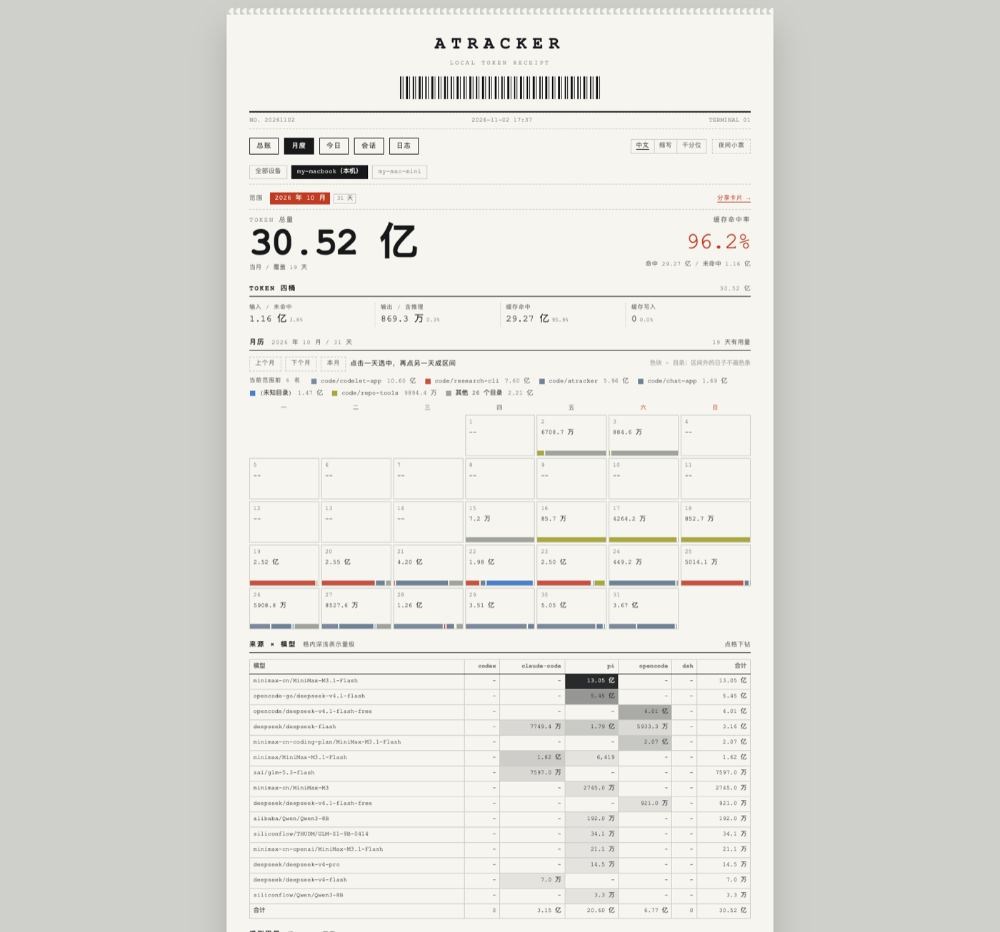
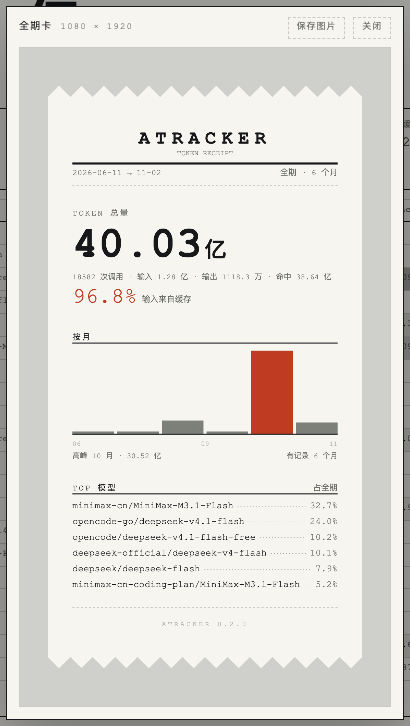

<p align="center">
  
</p>

<h1 align="center">ATracker</h1>

<p align="center">
  本机 AI 编码 agent 的 token 用量看板<br>
  只读日志，不加钩子，不改 agent 行为，不上传数据
</p>



| 月度：日历与选区 | 分享卡片：一键导出 1080×1920 |
| --- | --- |
|  |  |

## 它解决什么问题

同时用 codex、Claude Code、pi、opencode、DeepSeek Harness 的人会碰到同一件事：每个 agent 都把用量记在自己家目录里，彼此不通，加起来是多少没人知道。

ATracker 只读这些已经落盘的日志，统一成一套口径，写进本地 SQLite，然后给出一张看板：总量、四桶、缓存命中率、来源和模型的交叉表、目录排名、日历、会话明细。采集、计算、存储、展示全部在本机完成。

## 功能

| 功能 | 说明 |
| --- | --- |
| 五个来源 | codex、Claude Code、pi、opencode、DeepSeek Harness，增量扫描，文件变了自动重采 |
| 总账 | 全期累计：token 总量、四桶、缓存命中率、来源 × 模型交叉表、模型与目录排名 |
| 月度 | 带月历，选一天或一段区间看构成 |
| 今日 | 某一天的按小时分布、当天的会话、最大的几次调用、扫描情况 |
| 会话 | 按目录分组的两级列表，点进去看单个会话的逐轮 token 和模型构成 |
| 分享卡片 | 一键把当前范围或今天导成 1080×1920 的 PNG |
| 多设备同步 | 每台机器把汇总写进共享目录，读别人的文件加总，文件互不改动 |
| 桌面版 | macOS 应用，双击即用，不用开终端 |

## 安装

### 从源码跑

需要 Node 24 以上（用了 Node 自带的 `node:sqlite` 和 TypeScript 类型剥离）。

```bash
npm install
npm run scan      # 扫描本机日志，写入 data/atracker.db
npm run desktop   # 打开桌面窗口
```

运行时零依赖：SQLite 用 Node 自带的 `node:sqlite`，前端构建完就和应用一起打包。
`npm install` 装的是构建用的 React、Vite 和 electron-vite。

### 桌面版

```bash
npm run desktop            # 开发：改代码即时生效
npm run desktop:prod       # 用构建产物跑一遍，验证打包后的行为
npm run dist:mac:unsigned  # 出 dmg 和 zip 到 release/
```

未签名的包第一次打开要右键「打开」。打包细节见[桌面应用](docs/desktop.md)。

## 支持的数据来源

| Agent | 读哪里 |
| --- | --- |
| codex | `~/.codex/sessions/**/*.jsonl`、`~/.codex/state_5.sqlite` |
| Claude Code | `~/.claude/projects/**/*.jsonl` |
| pi | `~/.pi/agent/sessions/**/*.jsonl` |
| opencode | `~/.local/share/opencode/opencode.db` |
| DeepSeek Harness | `~/.dsh/sessions/**` |

读的是这些工具自己写的日志，不需要它们做任何配合。

## 常用命令

```bash
npm run scan                    # 手动扫一次
npm run stats                   # 打印累计用量
npm run typecheck               # 主进程、服务层和前端各跑一遍 tsc
npm run build                   # 构建 main / preload / renderer 到 out/
node packages/cli/src/index.ts doctor      # 看各来源是否可读
node packages/cli/src/index.ts reconcile   # 拿各来源自带的汇总数据对账
node packages/cli/src/index.ts sync export  # 多设备同步，手动导一次
```

界面只在桌面窗口里，不开监听端口，也没有浏览器版。这样本机的用量、
会话标题和目录路径不会因为一个开着的端口被同网段看到。

## 文档

| 文档 | 内容 |
| --- | --- |
| [口径](docs/metrics.md) | 四个桶、三种单位、时间、子 agent、厂商怎么算 |
| [架构](docs/architecture.md) | 分层、采集触发、聚合表、代码规则、前后端接口 |
| [界面设计](docs/design.md) | 小票风格、颜色语义、柱状图、分享卡片的取舍 |
| [多设备同步](docs/sync.md) | 同步什么、文件格式、两台机器怎么配 |
| [桌面应用](docs/desktop.md) | 打包、版本号、Electron 壳做了什么 |
| [开发](docs/development.md) | 目录结构、加一个 agent、测试、代码规则 |
| [容易踩的坑](docs/pitfalls.md) | 五个来源的日志格式陷阱，改采集器前必看 |
| [为什么不折算金额](docs/why-no-cost.md) | 只统计 token 的原因 |

## 已知限制

- **只统计 token，不折算成本。** 订阅制渠道、同名模型多渠道、阶梯价让金额口径收敛不出来，理由见[上面那篇文档](docs/why-no-cost.md)。
- **按天聚合走固定时区**（Asia/Shanghai，写死在 `core/time.ts`），不跟随系统时区。多设备同步需要两边分桶边界一致。
- **同步只带聚合，不带逐轮明细。** 所以切到别的设备时没有调用次数、小时图和单条明细。
- **目录按绝对路径归并。** 两台机器上用户名不同的同一个项目会被当成两个目录。
- **未签名。** 目前没有 Apple Developer ID，分发给别人需要对方右键打开。

## 参与

提 issue 前先看[容易踩的坑](docs/pitfalls.md)。改动采集器请附带 `reconcile` 的对账结果。细节见 [CONTRIBUTING.md](CONTRIBUTING.md)。

## 协议

[MIT](LICENSE)
